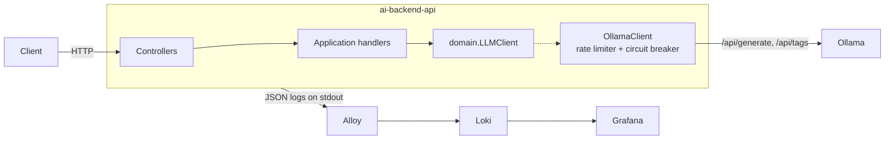
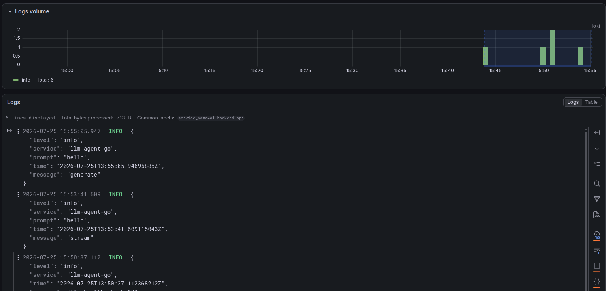

# LLM Agent Go

[](https://github.com/carlRondoni/llm-agent-go/actions/workflows/go.yml)

An inference gateway written in Go for a local LLM. It exposes a model running in [Ollama](https://ollama.com/) through a small HTTP API, with token streaming, a rate limiter and a circuit breaker in front of the model. Nothing leaves your machine, and no API keys are needed.

The service is designed to run locally. It has no authentication, and its rate limit is a single limit shared by everyone, so don't expose it publicly.

## Features

- Text generation, either as a single JSON response or streamed chunk by chunk as the model produces it
- Client disconnects cancel the request to Ollama, so an abandoned stream stops waiting on the model
- Rate limiting and a circuit breaker on every call to Ollama
- Health endpoints for the API and for Ollama
- Structured JSON logs, collected in Loki and viewable in Grafana
- Unit tests, plus integration tests against a real Ollama, all run in CI

## Quickstart

You need Docker with Compose, and about 5 GB of disk space for the `llama3` model. Running the tests also requires Go 1.25.6 or later.

1. Start all services and download the model:
   ```bash
   make local-complete-first-start
   ```

2. Generate some text:
   ```bash
   curl localhost:8080/llm/generate \
     -H 'Content-Type: application/json' \
     -d '{"prompt":"Explain a circuit breaker in one sentence."}'
   ```
   The first answer can take a while, because Ollama has to load the model into memory.

3. Stream the same answer as it's generated:
   ```bash
   curl -N localhost:8080/llm/stream \
     -H 'Content-Type: application/json' \
     -d '{"prompt":"Explain a circuit breaker in one sentence."}'
   ```

4. Stop everything when you're done. The downloaded model is kept:
   ```bash
   make docker-stop
   ```

After changing the code, rebuild the API with `make docker-start-build`. Run `make help` to see every target.

## API

### `POST /llm/generate`

Sends the prompt to the model and returns the whole answer once it's complete.

```json
{
  "prompt": "Explain distributed systems"
}
```

`prompt` is required. Returns `200 OK`:

```json
{
  "response": "Distributed systems are..."
}
```

### `POST /llm/stream`

Takes the same body as `/llm/generate`, and returns the answer as it's generated. See [Streaming](#streaming).

### Health checks

| Endpoint | Checks | Healthy | Unhealthy |
|---|---|---|---|
| `GET /health` | The API itself | `200` with an empty body | No response |
| `GET /llm/health` | Ollama, through `GET /api/tags` | `200` `{"status":"ok","llm":"up"}` | `503` `{"status":"degraded","llm":"down"}` |

`/llm/health` goes through the same rate limiter and circuit breaker as generation. It reports `down` while the breaker is open, even if Ollama has recovered, and a failed check counts toward opening the breaker.

### Errors

| Status | Cause | Body |
|---|---|---|
| `400` | Invalid JSON, or a missing or empty `prompt` | Plain text |
| `405` | Wrong HTTP method | Plain text |
| `500` | Generation failed, or a stream failed before its first chunk | `{"error":"..."}` |
| `503` | `GET /llm/health` with Ollama down | `{"status":"degraded","llm":"down"}` |

Some `500` causes are Ollama being unreachable, the circuit breaker being open (`{"error":"circuit breaker is open"}`), or Ollama answering `/llm/generate` with an error status.

## Streaming

Streaming is the main reason this service exists. `POST /llm/stream` answers `200` with `Content-Type: text/plain` and `Transfer-Encoding: chunked`, and writes each fragment of text as soon as Ollama produces it. The fragments have no framing, so the answer is just their concatenation.

Use `curl -N` to watch it, as in the [Quickstart](#quickstart). `-N` turns off curl's output buffering. API clients such as Postman or Bruno usually wait for the whole response before showing anything, so they make a stream look like a slow normal request.

### Cancellation

When a client disconnects in the middle of a stream, the request to Ollama is cancelled too:

1. Go's HTTP server cancels the request context when the client connection closes.
2. The controller passes that same context to the application handler, which passes it to `OllamaClient.Stream`.
3. `Stream` builds the Ollama request with `http.NewRequestWithContext`, so the HTTP transport aborts it.
4. Reading the response fails, the reading goroutine closes the channel, and the controller returns.

Two tests prove this. In both, the client reads the first chunk, disconnects, and the test checks that the request to Ollama is cancelled:

- `TestStreamController_ClientDisconnectCancelsUpstream`, a unit test, uses the real controller, handler and client against a fake Ollama.
- `TestAPI_StreamDisconnect_CancelsOllamaRequest_Integration` does the same against the real Ollama. A pass-through proxy between the client and Ollama shows that Ollama's response is cut off rather than read to the end. The test then checks that the service still answers.

`/llm/generate` passes its context down the same way.

### Limitations

- Once the first chunk is sent, the status is already `200`. A failure after that point can't reach the client, so a truncated stream looks like a normal end.
- The status code Ollama returns for a stream isn't checked. If Ollama answers with an error, the client gets an empty `200`.
- The 2-minute timeout of the Ollama HTTP client also covers reading the response, so no stream can last longer than that.

## Architecture



The code follows Clean Architecture, with dependencies pointing inward:

| Layer | Path | Contains |
|---|---|---|
| Domain | `internal/domain` | The `LLMClient` interface |
| Application | `internal/application` | One handler per use case: generate, stream and LLM health |
| Infrastructure | `internal/infrastructure` | HTTP controllers and the Ollama client |
| Wiring | `cmd` | Entry point, routes, and dependency injection |

The domain and application layers only use the standard library. Adding another LLM provider means implementing `domain.LLMClient` in `internal/infrastructure/llm_clients` and wiring it in `cmd/service_container`.

## Resilience

Every call to Ollama goes through a rate limiter first, then a circuit breaker. `/llm/generate`, `/llm/stream` and `/llm/health` share one limiter and one breaker, and so do all clients.

### Rate limiter

A token bucket from `golang.org/x/time/rate` that allows 2 requests per second, with bursts of up to 5.

The limiter waits instead of rejecting. A request over the limit is held until a token is free or until its context is cancelled, so the API never answers `429`. A request cancelled while waiting never reaches Ollama or the breaker.

### Circuit breaker

[gobreaker](https://github.com/sony/gobreaker), set up in `internal/infrastructure/llm_clients/ollama_client.go`:

| Setting | Value | Effect |
|---|---|---|
| Trip condition | More than 3 consecutive failures | The 4th consecutive failure opens the breaker |
| `Interval` | 60 seconds | While closed, failure counts reset every 60 seconds |
| `Timeout` | 10 seconds | After 10 seconds open, the breaker goes half-open |
| `MaxRequests` | 1 | Half-open allows one trial request. If it succeeds, the breaker closes; if it fails, it opens again |

While the breaker is open, calls fail at once with `circuit breaker is open`. During the half-open trial, other calls fail with `too many requests`.

What counts as a failure depends on the call:

| Call | Failure |
|---|---|
| Generate | A transport error, including a cancelled or timed-out request, or a status of `400` or higher |
| Stream | A transport error before the response headers arrive. Any status counts as success, and nothing after the headers is counted |
| Health | A transport error, or a status of `500` or higher |

## Logs

The API writes structured JSON logs to stdout with [zerolog](https://github.com/rs/zerolog). Alloy collects the logs of every container, labels them with the container name, and sends them to Loki.

To view them, add a Loki data source in Grafana (http://localhost:3000) with the URL `http://loki:3100`, then run `{service_name="ai-backend-api"}` in Explore.



Every `/llm/generate` and `/llm/stream` request logs the full prompt in the `prompt` field.

Logs are the only telemetry. The Ollama client creates OpenTelemetry spans, but no exporter is configured, so they go nowhere.

## Configuration

The API reads these environment variables:

| Variable | Required | Default | Purpose |
|---|---|---|---|
| `OLLAMA_URL` | Yes | None. The API exits at startup if it's missing | Base URL of Ollama |
| `OLLAMA_MODEL` | No | `llama3` | Model used for generation |

With Docker, Compose takes them from your shell or from `.env`, and otherwise uses `http://ollama:11434` and `llama3`. `make local-init` creates `.env` from `.env.example` if it doesn't exist yet. If you change `OLLAMA_MODEL`, pull the new model with `make docker-pull-model`.

To run the API outside Docker against the Compose Ollama, use `OLLAMA_URL=http://localhost:11434 go run ./cmd/api`.

The port (`8080`), the rate limit, the circuit breaker settings and the 2-minute Ollama timeout are set in the code.

## Services

| Service | URL | Purpose |
|---|---|---|
| API | http://localhost:8080 | This service |
| Ollama | http://localhost:11434 | Runs the model |
| Grafana | http://localhost:3000 | Log viewer, no login required |
| Loki | http://localhost:3100 | Log storage, fed by Alloy |

## Testing

| Command | Runs | Requires |
|---|---|---|
| `make test-unit` | Unit tests, using mocks and `httptest` | Go |
| `make test-integration` | Integration tests against a real Ollama, with no mocks | Go, Docker, and the downloaded model |
| `make test` | Both | Same as integration |
| `make test-coverage` | Unit tests with a coverage summary | Go |

`make test-integration` and `make test` rebuild and start the Docker stack and pull the model first, so they always test the current code. They use the same `OLLAMA_MODEL` as the API.

Unit tests use hand-written mocks and fake Ollama servers to reach failures that a real Ollama doesn't produce on demand. The integration tests use no mocks:

- the API happy paths for health, generate and stream;
- validation errors: `400`, `405`, and `404` on the old `/health/llm`;
- a model Ollama doesn't have: `500` from generate, and the empty `200` from stream described in [Limitations](#limitations);
- cancellation of the request to Ollama when a stream client disconnects.

The last two run the real controllers, handlers and Ollama client in the test process, so they can choose the model and watch the requests to Ollama.

Tests are separated with the `unit` and `integration` Go build tags. A plain `go test ./...` runs the unit tests. GitHub Actions runs linting, the build, and unit tests, then the integration tests with Ollama as a service container and the small `qwen2.5:0.5b` model. The integration tests only check that text comes back, not what it says, so any model works.

## Design decisions

- **Wait instead of rejecting.** A local Ollama has little capacity, and the expected user is one person. For them, a request that waits is more useful than a `429`. 2 requests per second with bursts of 5 lets a few requests in at once without piling work on the model.
- **Trip on the 4th consecutive failure, retry after 10 seconds.** A single failed request, such as one that times out while the model loads, shouldn't stop the service. Several in a row more likely mean Ollama is down. 10 seconds keeps a short outage short without retrying in a tight loop, and a single half-open trial avoids flooding Ollama as it comes back.
- **A 2-minute Ollama timeout.** The first request has to load the model into memory, which on a CPU can take longer than common HTTP timeouts.
- **One limiter and one breaker for everything.** It's the simplest setup that protects a single Ollama.

In production, I would change this:

- Limit each client separately and answer `429` with `Retry-After`, instead of one shared limiter that queues.
- Keep health checks out of the breaker and the limiter, so they report Ollama's real state and don't use up its capacity.
- Check Ollama's status before starting a stream, and tell the client when a stream ends early, for example with a final event.
- Make the port, the timeouts, and the limiter and breaker settings configurable.
- Add metrics and trace exporting, stop logging full prompts, and shut down gracefully.

Out of scope for this project: authentication, prompt-injection mitigation, more than one LLM provider, and metrics.

## Tech stack

- **Language:** Go, with the standard `net/http` server
- **LLM runtime:** Ollama, with `llama3` by default
- **Logging:** zerolog, Alloy, Loki, and Grafana
- **Resilience:** gobreaker and `golang.org/x/time/rate`
- **Testing:** testify and `httptest`

## License

[MIT](LICENSE)
