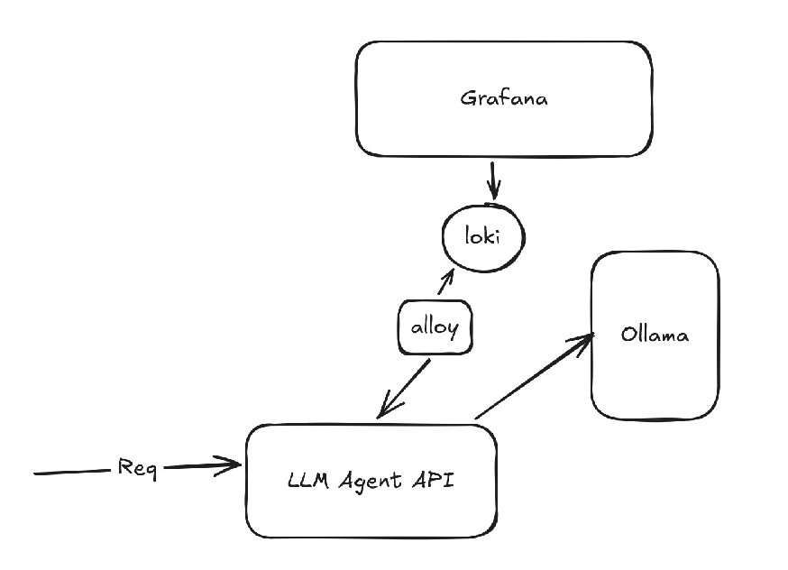

# LLM Agent Go


Production-style backend service that exposes an HTTP API to interact with an LLM engine through a resilient, observable, and testable architecture.

This project is intentionally designed as an engineering showcase: it demonstrates capability in backend architecture, distributed system thinking, fault tolerance, and observability design expected in modern Go systems.

## Table of Contents
- [Features](#features)
- [Architecture Overview](#architecture-overview)
- [Resilience Strategy](#resilience-strategy)
- [Observability](#observability)
- [Getting Started](#getting-started)
- [API Endpoints](#api-endpoints)
- [Testing](#testing)
- [Services & Environment](#services--environment)
- [CI](#ci)
- [License](#license)

## Features

- Clean architecture layering (Domain → Application → Infrastructure)
- LLM abstraction via interface
- Streaming and non-streaming generation
- Circuit breaker protection
- Rate limiting
- Structured logging
- Docker observability stack
- Tests

## Architecture Overview



### Project Structure

```text
llm-agent-go/
├── cmd/
│   └── api/                # Application entrypoint & DI container
├── internal/
│   ├── domain/             # Business logic, entities, interfaces (No external deps)
│   ├── application/        # Use-cases & orchestration logic (Handlers)
│   └── infrastructure/     # External integrations (Controllers, LLM Clients)
├── docs/                   # Documentation assets
├── docker-compose.yml      # Local infrastructure definition
└── Makefile                # Task runner commands
```

### Internal Layers

| Layer          | Responsibility                 |
| -------------- | ------------------------------ |
| Application    | Use-cases                      |
| Domain         | llm interface                  |
| Infrastructure | llm integrations + Controllers |

## Resilience Strategy

The LLM client is protected by three layers:

### Rate Limiter
Prevents request bursts from overwhelming the model or infrastructure.

### Circuit Breaker
Stops sending requests when failures exceed a threshold.

State machine:
```
Closed → Open → Half-Open → Closed
```
Trip condition:
```
> 3 consecutive failures
```
Purpose:
- protect upstream
- avoid cascading failures
- reduce resource waste

### Context Cancellation
Every request respects context:
- client disconnect → request stops
- timeout → request stops
- upstream cancelled → propagation stops

## Observability

The service emits telemetry from day one.

### Logs
Structured logs (zerolog) written to stdout.

Collected by:
- Loki (log storage)
- Alloy (collector)
- Grafana (dashboards)

*(Tip: Cuando tengas configurado Grafana con algo de tráfico, te sugiero reemplazar este texto con un screenshot de tus dashboards para un gran impacto visual)*

## Getting Started

### Prerequisites
Before you begin, ensure you have the following installed:
- [Docker & Docker Compose](https://docs.docker.com/get-docker/)
- [Make](https://www.gnu.org/software/make/)

### Running Locally

Init local (creates `.env`):
```bash
make local-init
```

First time init local (Starts docker and pulls the model):
```bash
make local-complete-first-start
```

Start stack:
```bash
make local-docker-start
```

Build and Start:
```bash
make local-docker-build-and-start
```

Stop:
```bash
make local-docker-stop
```

Restart:
```bash
make local-docker-restart
```

Rebuild + start:
```bash
make local-docker-restart-and-build
```

### After init first time

After start the first time you need to pull the model you want to have on your docker container:

```bash
make local-docker-post-start
```

After that request to the generate endpoint to warmup the model, so it is ready to serve requests. First time will be slowest request, but it will be faster on subsequent requests.

Also remember to connect loki to grafana:
- in your browser go to `http://127.0.0.1:3000`
- on left sidebar navigate to connections
- expand it and click on data sources
- click on 'Add new data source'
- search and select loki
- add the url `http://loki:3100`
- click on save & test
- after that you can go into explorer and see your logs using filter `app=ai-backend-api`

## API Endpoints

### Generate Text
`POST /llm/generate`

Body:
```json
{
  "prompt": "Explain distributed systems"
}
```

Response:
```json
{
  "response": "..."
}
```

### Stream Text
`POST /llm/stream`

Returns streamed chunks as they are generated.

NOTE: to test properly in local this endpoint you should do `curl -N http://127.0.0.1:8080/llm/stream -H "Content-Type: application/json" -d '{"prompt": "hello"}'` instead of using normal api clients (postman, bruno,...)

### LLM Health Check
`GET /health/llm`

Returns:
- 200 → LLM reachable
- 500 → LLM unavailable

### Health Check
`GET /health`

## Testing

To run the internal tests (Domain & Application layers) you can use the standard Go toolchain if you have Go installed locally:

```bash
go test -v ./...
```

## Services & Environment

### Services
| Service | Port  | Purpose       |
| ------- | ----- | ------------- |
| API     | 8080  | main service  |
| LLM     | 11434 | model backend |
| Grafana | 3000  | dashboards    |
| Loki    | 3100  | logs          |

### Environment Variables
| Variable   | Description  |
| ---------- | ------------ |
| OLLAMA_URL | LLM base URL |

## CI

Every time you create a PR or push into main, CI will build and test the project.

## License

MIT
